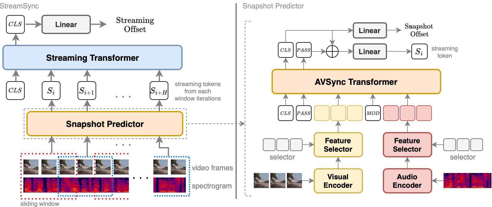

# StreamSync

**Streaming audio–visual synchronization for real-world videos.**

Code accompanying [Temporally Streaming Audio-Visual Synchronization for Real-World Videos](https://openaccess.thecvf.com/content/WACV2025/papers/Voas_Temporally_Streaming_Audio-Visual_Synchronization_for_Real-World_Videos_WACV_2025_paper.pdf), **WACV 2025**.

Jordan Voas, Wei-Cheng Tseng, Layne Berry, Xixi Hu, Puyuan Peng, James Stuedemann, and David Harwath.

[Paper](https://openaccess.thecvf.com/content/WACV2025/papers/Voas_Temporally_Streaming_Audio-Visual_Synchronization_for_Real-World_Videos_WACV_2025_paper.pdf) · [Supplement](https://openaccess.thecvf.com/content/WACV2025/supplemental/Voas_Temporally_Streaming_Audio-Visual_WACV_2025_supplemental.pdf) · [RealSync dataset](https://github.com/jvoas655/RealSync) · [Dataset release](https://github.com/jvoas655/RealSync/releases/tag/v0.1.0)

## Overview

StreamSync estimates the temporal offset between the audio and visual streams of a video. It processes successive short windows and carries learned streaming tokens between predictions, allowing synchronization evidence to accumulate over time. This is particularly useful when visible and audible events are sparse or intermittent.



*Figure 3 from the author-provided WACV paper source. Input windows are processed sequentially; the diagram illustrates how their streaming tokens are combined.*

The paper's snapshot predictor builds on **SparseSync**. It produces an immediate offset prediction and a streaming token derived from its classification and passthrough tokens. A streaming head uses the token history to make a prediction with longer temporal context.

The task uses 21 offset classes spanning −2 to +2 seconds in 0.2-second increments. Positive injected offsets select later source audio, making the audible event lead its visual counterpart. The paper studies both Transformer and LSTM streaming heads; this checkout contains the Transformer implementation.

## Repository status

This is the original research checkout, developed around AWS EC2/S3 and inherited SparseSync components. Some dataset paths, checkpoint references, and cluster scripts remain specific to that environment. A standalone local-server workflow and paper-checkpoint validation are pending; the setup below describes the existing code.

StreamSync's snapshot code is inherited from [SparseSync](https://github.com/v-iashin/SparseSync). **Synchformer** is a comparison model in the paper, and **AS-Synchformer** is subsequent work with a separate implementation. This repository should not be treated as their code release.

## RealSync dataset

Dataset manifests, annotations, reconstruction tooling, and documentation are maintained separately in [jvoas655/RealSync](https://github.com/jvoas655/RealSync).

The public [v0.1.0 metadata release](https://github.com/jvoas655/RealSync/releases/tag/v0.1.0) freezes the author-selected **cleaned uniform-offset collection**:

| Split | Source videos | Samples |
|---|---:|---:|
| Train | 511 | 269,890 |
| Validation | 74 | 16,944 |
| Test | 85 | 16,529 |

It contains 670 sources, 11,039 clip definitions, and 303,363 sample instructions, together with saved talking-head, voice-over, and BEATs audio-event annotations. Researchers obtain source videos independently; the dataset release does not redistribute them.

Start with the [dataset guide](https://github.com/jvoas655/RealSync/blob/v0.1.0/docs/DATASET_GUIDE.md), [reconstruction walkthrough](https://github.com/jvoas655/RealSync/blob/v0.1.0/docs/RECONSTRUCTION.md), and [reproducibility notes](https://github.com/jvoas655/RealSync/blob/v0.1.0/docs/REPRODUCIBILITY.md). Exact full-video cutting, complete historical re-encoding, and annotation timestamp registration remain unresolved. The selected release differs from the WACV paper's headline clip count and described normal-offset protocol.

The historical StreamSync loader has its own seek/slicing behavior, reversed validation/test aliases, private skip lists, and a 2,000-row evaluation cap. Its outputs and effective evaluation population are not interchangeable with the released dataset's strict reference reader. Record the actual manifest mapping and evaluated IDs when comparing results.

## Environment setup

The inherited environment export specifies Python 3.8, PyTorch 1.11, torchvision 0.12, torchaudio 0.11, and CUDA 11.3. It is retained as a historical starting point rather than a freshly verified installation recipe.

```bash
git clone https://github.com/jvoas655/StreamSync.git
cd StreamSync
conda env create -f conda_env.yml
conda activate sparse_sync
```

The environment name remains `sparse_sync` because it is defined in the existing export. The AWS data loader also imports `s3fs`, which is absent from that export and must be installed separately for the historical S3 workflow.

Check the imported libraries and the CPU VideoReader backend required by the loader:

```bash
python -c "import torch, torchvision, torchaudio; print(torch.__version__, torchvision.__version__, torchaudio.__version__)"
python -c "import torchvision; torchvision.set_video_backend('video_reader'); print(torchvision.get_video_backend())"
```

Some torchvision distributions omit the native FFmpeg VideoReader extension. A successful import alone does not establish a working decoder. Exact environment and decoder validation will accompany the portability update.

## Model code and configurations

| Path | Purpose |
|---|---|
| [main.py](main.py) | Configuration loading and training dispatch |
| [model/sync_model.py](model/sync_model.py) | Snapshot and streaming model interfaces |
| [model/modules/feature_selector.py](model/modules/feature_selector.py) | Sparse selectors, streaming tokens, and streaming Transformer |
| [scripts/train_sync.py](scripts/train_sync.py) | Synchronization training and evaluation |
| [scripts/train_utils.py](scripts/train_utils.py) | Dataset/model construction, distributed utilities, and checkpoint loading |
| [dataset/sports_and_news.py](dataset/sports_and_news.py) | Historical RealSync-style loader with EC2/S3 assumptions |
| [configs/streaming_sparse_sync.yaml](configs/streaming_sparse_sync.yaml) | Historical streaming Transformer configuration |
| [configs/sparse_sync.yaml](configs/sparse_sync.yaml) | Snapshot SparseSync configuration |
| [configs/sparse_sync_eval.yaml](configs/sparse_sync_eval.yaml) | Snapshot evaluation configuration |
| [conda_env.yml](conda_env.yml) | Inherited environment export |

`main.py` accepts OmegaConf configuration overrides using `key=value`. The existing streaming configuration uses 12 windows, a one-second hop, and a three-layer, 512-dimensional Transformer. It contains environment-specific media/log paths and an upstream starting checkpoint reference that must be checked before launching.

The original launcher pattern is:

```bash
# Requires the historical data/decoder setup and a trusted starting checkpoint.
# Select a GPU reserved for your job before launching.
torchrun --standalone --nproc_per_node=1 main.py \
  config=./configs/streaming_sparse_sync.yaml \
  ckpt_path=/path/to/trusted/snapshot-checkpoint.pt \
  logging.logdir=./logs/streamsync logging.use_wandb=False
```

This is a reference entry point, not a verified end-to-end reproduction command. The current loader forces its historical S3 media root; overriding `data.vids_path` alone does not make it a local-folder loader. The SLURM scripts and dataset-generation utilities are historical workflows that require separate review.

## Checkpoints and paper results

A trained **StreamSync checkpoint is not currently published in this repository's GitHub releases**. The tracked `S3D_kinetics400_torchified.pt` file is a visual feature extractor, and the inherited download registry refers to upstream SparseSync checkpoints. Neither is a trained StreamSync model.

Checkpoint identification, a small real-media verification, and publication are planned as a separate step. The historical [scripts/example.py](scripts/example.py) runs upstream SparseSync snapshot examples; it is not a StreamSync streaming demo.

The main WACV evaluation uses 18 five-second windows with a two-second hop. StreamSync and APA results use the final window; non-streaming baselines use the best prediction across windows. For StreamSync-Trf, the paper reports 0.566 accuracy, 0.841 ±1-class accuracy, 0.959 ROC AUC, and 0.621 mAP. These are published results, not fresh measurements of this checkout.

## Citation

Please cite the WACV paper when using StreamSync or RealSync, and identify the code commit, dataset release, checkpoint, and evaluation subset used:

```bibtex
@InProceedings{Voas_2025_WACV,
  author = {Voas, Jordan and Tseng, Wei-Cheng and Berry, Layne and Hu, Xixi and Peng, Puyuan and Stuedemann, James and Harwath, David},
  title = {Temporally Streaming Audio-Visual Synchronization for Real-World Videos},
  booktitle = {Proceedings of the IEEE/CVF Winter Conference on Applications of Computer Vision (WACV)},
  month = {February},
  year = {2025},
  pages = {5009--5017}
}
```

For the inherited snapshot model/code, also cite SparseSync:

```bibtex
@InProceedings{sparse2022iashin,
  title = {Sparse in Space and Time: Audio-visual Synchronisation with Trainable Selectors},
  author = {Iashin, Vladimir and Xie, Weidi and Rahtu, Esa and Zisserman, Andrew},
  booktitle = {British Machine Vision Conference (BMVC)},
  year = {2022}
}
```

Subsequent work: [Toward Robust Audio-Visual Synchronization Detection in Egocentric Video with Sparse Synchronization Events](https://bmvc2025.bmva.org/proceedings/903/) (BMVC 2025), with [AS-Synchformer code](https://github.com/jvoas655/AS-Synchformer).

```bibtex
@inproceedings{Voas_2025_BMVC,
  author = {Jordan Voas and Wei-Cheng Tseng and Benoit Vallade and Alex Mackin and David Higham and David Harwath},
  title = {Toward Robust Audio-Visual Synchronization Detection in Egocentric Video with Sparse Synchronization Events},
  booktitle = {British Machine Vision Conference (BMVC)},
  year = {2025},
  url = {https://bmvc2025.bmva.org/proceedings/903/}
}
```

RealSync's [citation guide](https://github.com/jvoas655/RealSync/blob/v0.1.0/docs/CITATIONS.md) documents source-publisher attribution and the S3FD, SyncNet, BEATs, and AudioSet contributions to its annotations.

## License and acknowledgements

The inherited code is MIT licensed; Vladimir Iashin's original copyright notice is retained in [LICENSE](LICENSE). This repository builds on [SparseSync](https://github.com/v-iashin/SparseSync), with inherited Transformer implementation patterns from [minGPT](https://github.com/karpathy/minGPT) and visual encoder code from [S3D](https://github.com/kylemin/S3D).

The architecture figure is reproduced from the author-provided WACV paper source. Dataset metadata and source-media rights are described separately in the [RealSync release](https://github.com/jvoas655/RealSync).
